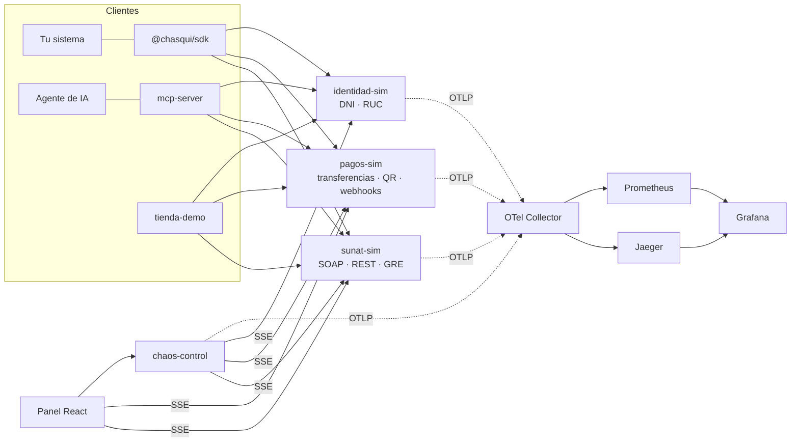

# Chasqui

[](https://github.com/Christopher-SDK/chasqui/actions/workflows/ci.yml)


> **Simulador para pruebas. No afiliado a SUNAT ni a ninguna entidad financiera.**
> Todos los datos (RUC, DNI, personas y billeteras) son ficticios.

[English](README.en.md) · [Demo de 5 minutos](docs/demo.md) · [Progreso por fases](docs/PROGRESO.md)

Chasqui es un laboratorio local (_digital twin_) del ecosistema digital peruano para probar
integraciones **antes** de tocar producción: comprobantes electrónicos en el formato UBL 2.1 que
usa SUNAT, guías de remisión, una billetera interoperable con QR y webhooks, consulta de DNI y RUC,
y un motor de **fallas inyectables y reproducibles**: caídas, latencia, respuestas truncadas, rate
limiting y duplicados.

¿Tu sistema factura bien cuando SUNAT responde 503 a fin de mes? ¿Cobras dos veces si el cliente
reintenta? ¿Pierdes el comprobante si el pago se confirmó pero el envío falló? Chasqui te deja
reproducir esos escenarios en tu máquina y en tu CI, con la misma semilla cada vez.

## Arranque

```bash
docker compose up -d                                  # simuladores + panel + tienda demo
docker compose --profile observabilidad up -d         # + Grafana, Jaeger y Prometheus
```

Sin Docker: `pnpm install && pnpm todo-en-uno` (los cuatro servicios en un proceso).

| Servicio                         | URL                                    |
| -------------------------------- | -------------------------------------- |
| Panel en vivo                    | http://localhost:7500                  |
| sunat-sim · SOAP (WSDL)          | http://localhost:7100/billService?wsdl |
| sunat-sim · REST + OpenAPI 3.1   | http://localhost:7100/docs             |
| pagos-sim · billetera            | http://localhost:7200/docs             |
| identidad-sim · DNI y RUC        | http://localhost:7300/docs             |
| chaos-control                    | http://localhost:7400/docs             |
| tienda-demo (integra con el SDK) | http://localhost:7600                  |
| Grafana · Jaeger · Prometheus    | :3000 · :16686 · :9090                 |

Credenciales SOAP de prueba (como en el ambiente beta): usuario `<RUC>MODDATOS`, clave `moddatos`.

## Arquitectura



## Lo que lo hace confiable

- **Reglas oficiales como oráculo.** Las validaciones no se interpretan de la documentación: se
  portan de los XSL ejecutables que publica SUNAT (paquete SFS/OSE). Una prueba diferencial
  compara cada veredicto de Chasqui con el de la regla oficial: código, observaciones y orden.
  Coinciden en 478 casos dirigidos, 512 aleatorios y 200 válidos de comprobantes, 118 de bajas y
  resúmenes y 117 de guías de remisión ([ADR 0003](docs/adr/0003-oraculo-reglas-oficiales.md),
  [fuentes](docs/fuentes.md)).
- **Caos determinista.** Cada decisión de falla sale de `sha256(semilla, regla, clave#intento)`:
  la misma semilla reproduce la misma secuencia en tu máquina y en CI, y un reintento con la
  misma Idempotency-Key puede recuperarse, como con una falla transitoria real
  ([guía de caos](docs/guia-caos.md)).
- **Dinero sin sorpresas.** La base de datos garantiza la idempotencia (`UNIQUE`), incluso con 10
  peticiones concurrentes; los montos son céntimos enteros; los webhooks van firmados con HMAC y
  marca de tiempo, y se reintentan con backoff
  ([ADR 0008](docs/adr/0008-pagos-sim.md)).
- **Pruebas en todos los niveles.** Unitarias, de propiedades (fast-check), de conformidad,
  integración HTTP real, contratos Pact entre el SDK y cada simulador, E2E con Playwright en
  escritorio y móvil, mutation testing con Stryker (84 %) y carga con k6 con umbrales.

## Para integrar

- **SDK** ([docs/sdk.md](docs/sdk.md)): builders fluidos de comprobantes, reintentos
  idempotentes, `chasqui.chaos.con('cierre-de-mes', prueba)` y verificación de webhooks.
- **MCP** ([docs/mcp.md](docs/mcp.md)): 11 herramientas para que un agente de IA emita
  comprobantes, valide XML, transfiera y active fallas.
- **Bruno** ([bruno/](bruno/)): colección lista para explorar las APIs.
- **Observabilidad** ([docs/observabilidad.md](docs/observabilidad.md)): una compra en la tienda
  es una sola traza que cruza los cuatro servicios.
- **Carga** ([carga/](carga/README.md)): k6 con umbrales por servicio y reporte HTML.

## Desarrollo

```bash
corepack enable && pnpm install
pnpm sunat:preparar     # descarga y verifica (SHA-256) los XSL oficiales; requiere Python 3
pnpm test               # unitarias, propiedades, conformidad, integración y contratos
pnpm e2e                # Playwright
pnpm mutation           # Stryker sobre el validador
pnpm carga:preparar && pnpm carga   # k6
```

Decisiones de diseño en [docs/adr/](docs/adr/). Monorepo pnpm · Node 22 · TypeScript · Fastify ·
Zod/OpenAPI 3.1 · Kysely (SQLite o Postgres) · React + Vite + Tailwind.

## Limitaciones conocidas

Reglas no confirmadas en una fuente oficial (`TODO verificar` en el código):

- **2334 vs. 2335** (documento alterado): el catálogo oficial da el mismo mensaje a ambos códigos;
  Chasqui usa 2335 para cualquier alteración detectada en la firma.
- **Plazos**: el de facturas y notas (3 días, 2108) está confirmado por la RS 000003-2023/SUNAT;
  el de boletas sueltas y el de baja (7 días, 2958) no. Ambos son configurables ([fuentes §13](docs/fuentes.md)).
- **hashZip inválido en la GRE**: no se halló el código oficial; Chasqui responde 0156.
- **Orden de las reglas de servidor** (duplicado, firma, plazos): decisión documentada en el
  [ADR 0006](docs/adr/0006-reglas-de-servidor-en-sunat-sim.md).
- **Distribución de estados del RUC** y **límites de la billetera**: valores de Chasqui, no
  estadísticas ni límites oficiales.

Fuera del alcance actual:

- Operaciones gratuitas, IVAP, exportación, ISC, ICBPER, detracción, percepción, anticipos,
  descuentos y cargos, pago a crédito con cuotas.
- La firma no valida la cadena de confianza del certificado ni su pertenencia al RUC emisor.
- La guía de remisión cubre transporte privado (modalidad 02). En transporte público (modalidad 01)
  se valida hasta exigir el transportista (2558); el bloque de reglas del transportista, puertos y
  contenedores no está portado.

## Autor

Christopher Arias · [Montreach](https://montreach.com), Lima, Perú. Licencia [MIT](LICENSE).
